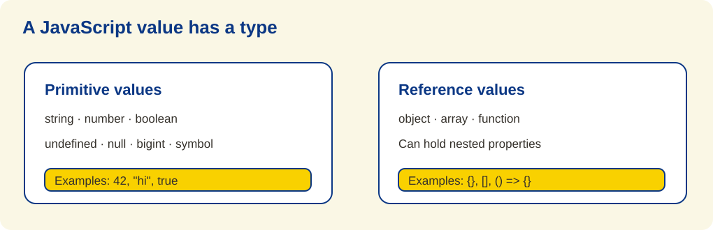

# 2: JavaScript Fundamentals — Variables, Values, and Data Types

**Goal:** Understand how JavaScript represents values and how explicit conversion prevents unreliable backend behavior.



## 2.1 Declaring Variables with const and let

Use `const` unless the variable must be reassigned. `let` allows reassignment. Neither makes an object immutable. Avoid `var` in new code: its function scope and hoisting behavior introduce unnecessary surprises.

~~~javascript {cmd="node"}
const school = "BeXpert";
let enrolled = 8;
enrolled += 1;
const course = { title: "Backend" };
course.title = "Node.js Backend";
console.log(school, enrolled, course.title);
~~~

**Backend connection:** Request data often changes as a program runs, but configuration and references usually should not be reassigned.

**Common mistake:** `const` prevents rebinding, not changing nested properties. A variable declared with `let` or `const` cannot be accessed before its initialization.

**Practice:** Replace `let enrolled` with `const enrolled`. What error do you expect?

### Reassignment is different from mutation

A variable identifies a value. When you write `let total = 10` and later `total = 11`, you **reassign** the variable. With `const task = { done: false }`, the variable still refers to the same object after `task.done = true`. Only its property changes.

| Declaration | Reassign the variable? | Scope |
|---|---|---|
| `const` | No | Block |
| `let` | Yes | Block |
| `var` | Yes | Function (generally avoid in new code) |

```javascript {cmd="node"}
let count = 2;
count = count + 1;
const settings = { retries: 2 };
settings.retries = 3;
console.log({ count, settings }); // { count: 3, settings: { retries: 3 } }
```

A useful rule: **start with `const`**, and use `let` only when reassignment is part of the design. This makes changes easier to locate when debugging.

## 2.2 Understanding JavaScript Data Types and Values

Primitive values include string, number, boolean, bigint, undefined, null, and symbol. Objects (including arrays and functions) are reference values. JavaScript uses dynamic typing: variables can refer to different kinds of values over time.

~~~javascript {cmd="node"}
const values = ["abc", 42, true, 7n, undefined, null, Symbol("id"), {}, []];
for (const value of values) {
  console.log(String(value), "=>", typeof value);
}
console.log(Array.isArray([]));
~~~

**Backend connection:** APIs accept text over the network; even if an input is expected to be numeric, its value and type need validation at runtime.

**Common mistake:** `typeof null` is "object" (a historical quirk); `typeof []` is also "object". Use `Array.isArray` to check arrays.

**Practice:** Predict `typeof NaN`, `typeof (() => {})`, and `typeof 10n`.

### Primitives, objects, and missing values

A *primitive* represents a single value. An *object* can group fields, collections, or behavior. Because objects are reference values, two variables can refer to the same object:

```javascript {cmd="node"}
const a = { active: false };
const b = a;
b.active = true;
console.log(a.active); // true
console.log(typeof null); // "object"
console.log(Array.isArray([1, 2])); // true
```

`undefined` commonly means a property was not supplied; `null` is an explicit absence. They are not interchangeable in every context. For example, JSON supports `null` but not `undefined`.

**Dynamic typing** means JavaScript does not require declaring a variable's type. It does **not** mean an API should accept arbitrary types for a field. A `progress` field expected to be a number still needs checking.

## 2.3 Working with Operators and Expressions

Operators combine values to create expressions. Arithmetic (`+ - * / % **`), assignment (`= +=`), and string concatenation appear everywhere. Evaluate both the value and the type of an expression.

~~~javascript {cmd="node"}
const price = 120;
const quantity = 3;
const subtotal = price * quantity;
const hasDiscount = quantity >= 3;
const total = hasDiscount ? subtotal * 0.9 : subtotal;
console.log({ subtotal, total, remainder: quantity % 2 });
console.log("Order " + 12);
~~~

**Backend connection:** Money calculations should not rely on unchecked floating-point rounding; production financial systems use minor units or decimal-safe approaches.

**Common mistake:** `+` also concatenates strings; `100 + "5"` yields the string `"1005"`.

**Practice:** Why is `0.1 + 0.2 === 0.3` false?

### Expressions produce values

An expression is code that evaluates to a value: `price * quantity`, `quantity >= 3`, or `"Task " + id`. A statement performs a step, such as declaring a variable or using `if`.

Operator precedence affects evaluation, so parentheses help communicate intent:

```javascript {cmd="node"}
console.log(2 + 3 * 4); // 14
console.log((2 + 3) * 4); // 20
console.log(10 % 3); // 1
console.log(2 ** 3); // 8
```

**Floating-point note:** `0.1 + 0.2` is not represented as exactly `0.3`. Later, when building payment or accounting services, use a deliberate approach to money such as integer minor units or decimal-safe libraries.

## 2.4 Type Conversion and Type Coercion

Explicit conversion is a deliberate step (`Number`, `String`, `Boolean`). Coercion occurs implicitly during operations or comparisons. Treat external input as untrusted even when its numeric-looking text converts.

~~~javascript {cmd="node"}
const input = "25";
console.log(Number(input) + 5);
console.log(input + 5);
console.log(Number(""), Number("hello"));
console.log(Number.isNaN(Number("hello")));
console.log(Boolean("false"), Boolean(""));
~~~

**Backend connection:** Route parameters and form fields often start as strings. Validate converted values before using them in a query or calculation.

**Common mistake:** `Number("")` is zero and `Boolean("false")` is true. Silent conversions can turn missing or invalid data into plausible numbers.

**Practice:** Design a condition that accepts only positive integer IDs from a text input.

### Explicit conversion should be followed by validation

When an HTTP client sends the ID `"42"` in a URL, it is text. Conversion produces a number, but conversion alone does not establish that it is a valid ID:

```javascript {cmd="node"}
function parsePositiveId(raw) {
  if (typeof raw !== "string" || !/^[1-9]\d*$/.test(raw)) {
    throw new Error("ID must contain digits and be greater than zero");
  }
  const id = Number(raw);
  if (!Number.isSafeInteger(id)) throw new Error("ID is too large");
  return id;
}
console.log(parsePositiveId("42"));
for (const text of ["", "0", "abc"]) {
  try { parsePositiveId(text); }
  catch (error) { console.log(JSON.stringify(text), "=>", error.message); }
}
```

Notice the separate steps: check the input format, convert, then check the converted value. `Number(" ")` yields `0`, so simply checking whether conversion returns a number is insufficient.

## Review and practice

1. Revisit an example from this chapter. Predict its output, run it, and explain any difference.
2. Change one input or condition and test what changes.
3. Identify one situation in a backend API where the concept would be useful.

**Further reading:** [MDN JavaScript guide](https://developer.mozilla.org/en-US/docs/Web/JavaScript/Guide) · [Node.js learning](https://nodejs.org/en/learn)
