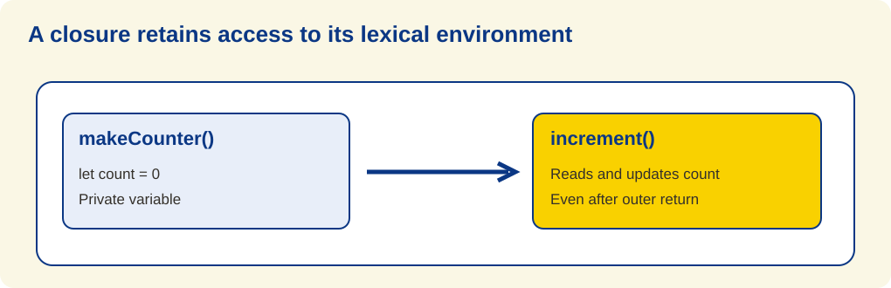

# Main Title 4: Functions and Reusable JavaScript Logic

**Goal:** Build small testable units of logic and understand how callbacks and scope affect behavior.

**Recording setup:** open this file in VS Code with Markdown Preview Enhanced. Each JavaScript block can be run independently. The snippets also read normally on GitHub.

## 4.1 Creating Functions with Declarations and Expressions

Functions package a task behind a meaningful name. A function declaration can be called before its declaration in the same scope. A function expression is assigned to a variable and follows that binding's initialization rules.

~~~javascript {cmd="node"}
console.log(toLabel("api"));
function toLabel(text) { return text.toUpperCase(); }
const formatId = function (id) { return "TASK-" + id; };
console.log(formatId(12));
~~~

**Why it matters for backend work:** Small named functions make validation, transformation, and business rules testable without starting a web server.

**Watch out:** Calling a function expression declared with `const` before initialization throws an error.

**Try it:** Refactor a repeated line of formatting logic into a reusable function.

## 4.2 Function Parameters, Arguments, Default Values, and return

Parameters name the inputs; arguments are actual passed values. Defaults are applied for missing or undefined arguments. `return` produces a value and stops execution; logging alone does not return a result.

~~~javascript {cmd="node"}
function calculateTotal(price, quantity = 1) {
  if (typeof price !== "number" || price < 0) throw new TypeError("Invalid price");
  if (!Number.isInteger(quantity) || quantity < 1) throw new TypeError("Invalid quantity");
  return price * quantity;
}
console.log(calculateTotal(75));
console.log(calculateTotal(75, 3));
~~~

**Why it matters for backend work:** A function with explicit inputs and outputs can be tested, reused, and connected to a route later.

**Watch out:** A default argument does not replace `null`; `calculateTotal(75, null)` still passes null.

**Try it:** Why does `console.log` inside a function not replace `return`?

## 4.3 Arrow Functions and Their Differences

Arrow functions offer concise syntax and lexical `this`. They do not have their own `arguments` or `this`, and cannot be constructors. Use regular methods or declarations when receiver-bound `this` is required.

~~~javascript {cmd="node"}
const double = n => n * 2;
const makeTask = (title, done = false) => ({ title, done });
console.log(double(6), makeTask("Review PR"));
const counter = {
  value: 2,
  increment() { this.value += 1; return this.value; }
};
console.log(counter.increment());
~~~

**Why it matters for backend work:** Arrow functions are common for callbacks and transformations; method syntax is clearer when the method uses the object as `this`.

**Watch out:** `const task = () => { title: "Test" }` does not return an object literal; wrap the object in parentheses.

**Try it:** Why should an object method using `this` usually not be an arrow function?

## 4.4 Understanding Scope and How Variables Are Accessed

Scope determines where a name can be used. `let` and `const` are block-scoped; nested functions can read names in outer lexical scopes. A closure retains access to those names after the outer function finishes.

~~~javascript {cmd="node"}
function makeCounter() {
  let count = 0;
  return function increment() { count += 1; return count; };
}
const first = makeCounter();
const second = makeCounter();
console.log(first(), first(), second());
if (true) { const hidden = "block"; console.log(hidden); }
~~~

**Why it matters for backend work:** Closures appear in middleware factories, configuration helpers, and callbacks. Avoid accidental shared mutable state when handling many requests.

**Watch out:** `hidden` above is not visible outside its block. Keeping mutable state at module scope can accidentally mix requests.

**Try it:** Predict the third call to `first()` and explain why `second()` starts at 1.

## 4.5 Callback Functions: Passing Functions as Arguments

A callback is a function passed to another function to be invoked later or during an operation. Not every callback is asynchronous; array methods call their callbacks synchronously.

~~~javascript {cmd="node"}
function processItems(items, transform) {
  const results = [];
  for (const item of items) results.push(transform(item));
  return results;
}
const titles = processItems(["login", "grades"], name => name.toUpperCase());
console.log(titles);
setTimeout(() => console.log("timer callback"), 0);
console.log("after scheduling");
~~~

**Why it matters for backend work:** Callbacks connect route handlers, array processing, timers, and later asynchronous JavaScript lessons.

**Watch out:** Passing `transform()` executes immediately; passing `transform` lets the receiving function call it.

**Try it:** Which callback runs synchronously here, and which one runs after the current synchronous code?

## Recap

Before moving on, explain the output of the examples without running them. Then change one input and predict what happens before executing.
