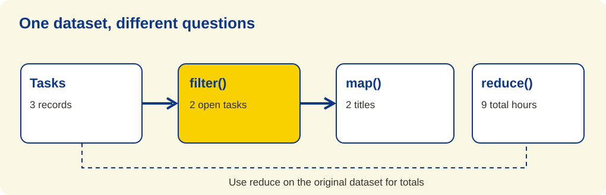

# Main Title 5: Arrays, Objects, and Data Manipulation

**Goal:** Safely prepare data for APIs by selecting, validating, transforming, and serializing records.

**Recording setup:** open this file in VS Code with Markdown Preview Enhanced. Each JavaScript block can be run independently. The snippets also read normally on GitHub.

## 5.1 Creating, Accessing, and Updating Arrays

Arrays are ordered collections. Access by zero-based index; use `push`, `pop`, or index assignment when mutation is intentional. Distinguish mutation from creating a new array.

~~~javascript {cmd="node"}
const topics = ["HTTP", "Git"];
topics.push("JavaScript");
console.log(topics[0], topics.at(-1), topics.length);
const copy = [...topics, "Node.js"];
console.log(topics, copy);
~~~

**Why it matters for backend work:** Backend services frequently receive arrays of records. Mutating shared data can lead to surprising bugs.

**Watch out:** `const` does not freeze the array; `push` changes its contents.

**Try it:** Which operation created a new array rather than modifying the original?

## 5.2 Processing Arrays with map, filter, find, forEach, and reduce

Choose the method based on your intended result: `map` transforms, `filter` selects, `find` returns the first match, `forEach` performs an action, `reduce` accumulates a result. These methods work with callbacks.

~~~javascript {cmd="node"}
const tasks = [
  { id: 1, title: "Plan", done: true, hours: 2 },
  { id: 2, title: "Code", done: false, hours: 4 },
  { id: 3, title: "Test", done: false, hours: 3 }
];
console.log(tasks.filter(t => !t.done).map(t => t.title));
console.log(tasks.find(t => t.id === 2));
console.log(tasks.reduce((sum, t) => sum + t.hours, 0));
tasks.forEach(t => console.log(t.id));
~~~

**Why it matters for backend work:** Transforming database results into public API responses often uses map/filter, but security filtering should also be enforced by the data-access layer.

**Watch out:** `forEach` returns undefined; `find` may return undefined; `map` preserves array length.

**Try it:** What would change if you replace `filter` with `map` for the unfinished tasks?

## 5.3 Creating and Working with Objects and Nested Objects

Objects hold named properties, and nested structures model related data. Property access can use dot or bracket notation. Objects are passed and assigned by reference.

~~~javascript {cmd="node"}
const student = { id: 3, name: "Sami", profile: { city: "Addis Ababa" } };
console.log(student.profile.city);
student["active"] = true;
const alias = student;
alias.name = "Updated";
console.log(student.name, Object.keys(student));
~~~

**Why it matters for backend work:** Objects represent request bodies and database records. Understand when a function mutates its input.

**Watch out:** `const alias = student` does not copy the object; both references point to the same object.

**Try it:** How would you safely read profile.city if profile might be absent?

## 5.4 Destructuring, Spread, Rest, and Optional Chaining

Destructuring extracts properties or array elements; spread expands elements or copies enumerable object properties; rest collects remaining values. Optional chaining safely stops when a base value is null or undefined.

~~~javascript {cmd="node"}
const input = { id: 2, name: "Hana", passwordHash: "secret", profile: { city: "Jimma" } };
const { passwordHash, ...publicUser } = input;
const updated = { ...publicUser, name: "Hana T." };
console.log(updated, input.profile?.city, input.address?.city ?? "Not provided");
const [first, ...others] = [10, 20, 30];
console.log(first, others);
~~~

**Why it matters for backend work:** Selecting public fields reduces accidental leaks. Destructuring can improve clarity but it does not replace validation.

**Watch out:** Spread is shallow: nested objects are still shared references. In security-sensitive code, explicitly allowlist fields instead of assuming omitting one secret is enough.

**Try it:** What happens if you mutate `updated.profile.city`?

## 5.5 Working with Strings and JSON Data

Strings provide input normalization (`trim`, `toLowerCase`, `includes`, `slice`). JSON is a text format that transports arrays and objects. `JSON.parse` throws for malformed data, and `JSON.stringify` does not preserve every JavaScript value.

~~~javascript {cmd="node"}
const rawName = "  ASTER  ";
const cleanName = rawName.trim().toLowerCase();
const payload = JSON.stringify({ name: cleanName, active: true });
console.log(payload, JSON.parse(payload).name);
try { JSON.parse("{invalid}"); }
catch (error) { console.log("Invalid JSON:", error instanceof SyntaxError); }
~~~

**Why it matters for backend work:** Most JSON APIs receive structured data; even valid JSON needs application-level schema validation.

**Watch out:** `JSON.stringify({a: undefined})` omits that property; JSON does not support functions or BigInt.

**Try it:** Why are JSON syntax validation and business-rule validation separate checks?

## Recap

Before moving on, explain the output of the examples without running them. Then change one input and predict what happens before executing.
