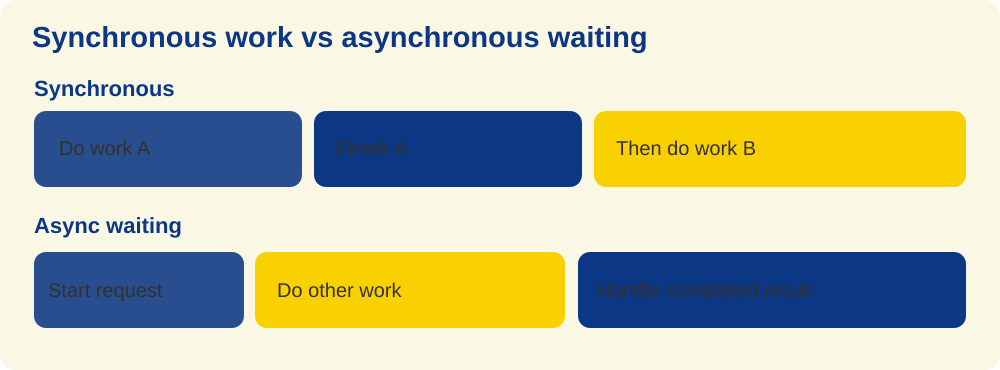
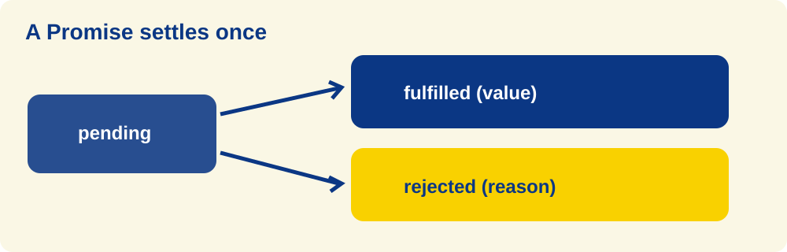

# Main Title 6: Asynchronous JavaScript

**Week 2 · One recorded lesson · Sections 6.1–6.6**

When a backend handles a request, it may need to wait for a file, database, or another service. JavaScript provides ways to start that work without freezing all other useful progress. This lesson explains what actually runs, what waits, how errors travel, and when independent tasks can overlap.

## What you'll learn

By the end you should be able to predict the order of simple asynchronous logs; use callbacks, promises, \`async\`/\`await\`, and \`try\`/\`catch\`; distinguish sequential from concurrent operations; and explain why asynchronous I/O does **not** automatically make CPU-heavy work faster.

**Try the examples:** Code fences marked \`javascript {cmd="node"}\` can run in VS Code with [Markdown Preview Enhanced](https://marketplace.visualstudio.com/items?itemName=shd101wyy.markdown-preview-enhanced) when execution is enabled for this *trusted* workspace. They are also readable on GitHub. If you prefer the terminal, the [single JavaScript demo file](../examples/06-asynchronous-javascript.js) has each example commented out for one-at-a-time execution. Run with \`node weeks/week-02/examples/06-asynchronous-javascript.js\` from the repository root.

## 6.1 Understanding Synchronous vs. Asynchronous Execution

**Synchronous code** runs in the order the statements execute. The current JavaScript work must finish before the next synchronous statement runs. **Asynchronous operations** can be started now and report their results later: for example, a timer, a file read, or a network operation.

### Synchronous example

~~~javascript {cmd="node"}
console.log("A: start");
console.log("B: work");
console.log("C: finish");
// A, B, C
~~~

This is predictable because every statement completes in sequence.

### Scheduling an operation

~~~javascript {cmd="node"}
console.log("A: start");
setTimeout(() => console.log("C: timer finished"), 0);
console.log("B: continue");
// A, B, C
~~~

\`setTimeout(..., 0)\` schedules a callback for a later timer phase. It **does not** interrupt the code that is currently running or guarantee instant execution.

An important distinction: asynchronous **waiting** is not the same thing as doing expensive calculations on another JavaScript thread. CPU-heavy synchronous code can still block responsiveness.

### Backend example

Imagine the server needs a student's course progress from another service. It can start the simulated request, continue other work, and handle the result when it arrives. In this lesson we use timers to simulate waiting without requiring internet access or API keys.

**Remember:** A timer demonstration is a model of waiting, not a real database or HTTP request.

**Practice:** Predict the order of \`"one"\`, \`"two"\`, and \`"later"\` if the timer is scheduled between the two logs. Why does delay 0 not mean “run first”?

## 6.2 Understanding Callbacks and Asynchronous Operations

A **callback** is a function passed to another function so that the receiving function can invoke it. Callbacks are not inherently asynchronous: \`array.map()\` uses synchronous callbacks, whereas \`setTimeout()\` schedules a callback for later.

~~~javascript {cmd="node"}
const names = ["Hana", "Sami"];
names.forEach(name => console.log("Now:", name));
setTimeout(() => console.log("Later: notification ready"), 0);
console.log("After scheduling");
// Now: Hana
// Now: Sami
// After scheduling
// Later: notification ready
~~~

A function can simulate a delayed lookup by accepting a callback to be invoked with a result:

~~~javascript {cmd="node"}
function loadStudent(id, callback) {
  setTimeout(() => callback({ id, name: "Hana" }), 30);
}
console.log("Requesting student");
loadStudent(7, student => console.log("Received:", student.name));
console.log("Doing something else");
// Requesting student
// Doing something else
// Received: Hana
~~~

**What to notice:** \`loadStudent\` is called now, while the callback runs later. Passing \`callback\` is not the same as invoking \`callback()\` immediately.

Callbacks can become hard to follow when each operation depends on the previous result. That nested shape is sometimes called *callback hell*—the real problem is difficult-to-manage control flow, error handling, and readability, not indentation alone. Promises provide another way to represent completion.

**Practice:** Which callback above runs synchronously? What will happen if you write \`setTimeout(console.log("Hi"), 100)\` instead of \`setTimeout(() => console.log("Hi"), 100)\`?

## 6.3 Working with Promises: \`then\`, \`catch\`, and \`finally\`

A **Promise** represents the eventual outcome of an asynchronous operation. It begins **pending** and eventually becomes **fulfilled** with a result or **rejected** with a reason. Once settled, it does not change to another state.

~~~javascript {cmd="node"}
function loadCourse() {
  return new Promise(resolve => {
    setTimeout(() => resolve({ id: 3, title: "Backend" }), 40);
  });
}

console.log("Starting course request");
loadCourse()
  .then(course => console.log("Course:", course.title))
  .catch(error => console.error("Failed:", error.message))
  .finally(() => console.log("Request finished"));
console.log("After starting request");
// Starting course request
// After starting request
// Course: Backend
// Request finished
~~~

- \`.then(handler)\` handles a fulfilled result. A return value from the handler becomes the next chain's result.
- \`.catch(handler)\` handles a rejection or error propagated from an earlier handler.
- \`.finally(handler)\` runs after the chain settles. It is generally for cleanup or status logging, not for replacing the result.

### Predict the order: synchronous code, promise, timer

~~~javascript {cmd="node"}
console.log("A");
setTimeout(() => console.log("timer"), 0);
Promise.resolve().then(() => console.log("promise"));
console.log("B");
// A
// B
// promise
// timer
~~~

In this simple Node.js example, current synchronous code runs first, then the promise's microtask, then the timer callback. This does **not** cover every nuance of Node.js event-loop phases.

### What happens on rejection?

~~~javascript {cmd="node"}
Promise.reject(new Error("Student not found"))
  .then(() => console.log("This is skipped"))
  .catch(error => console.log("Handled:", error.message))
  .finally(() => console.log("Lookup ended"));
// Handled: Student not found
// Lookup ended
~~~

Attach rejection handlers. An **unhandled rejection** is a real bug; Node.js behavior and process handling may depend on runtime configuration. A rejected promise does not become a valid student record.

**Practice:** Why isn't the first \`.then\` called in the rejection example? What does \`.finally\` run for?

## 6.4 Writing Asynchronous Code with \`async\` and \`await\`

An \`async\` function **always returns a Promise**. Within an async function, \`await\` suspends *that function's continuation* until the awaited value settles. It does **not** freeze the whole Node.js process or make every other task wait.

~~~javascript {cmd="node"}
const delay = ms => new Promise(resolve => setTimeout(resolve, ms));

async function getStudent() {
  await delay(40);
  return { id: 7, name: "Hana" };
}

console.log("Before calling");
const pending = getStudent();
console.log("Is it a Promise?", pending instanceof Promise);
pending.then(student => console.log("Result:", student.name));
console.log("After calling");
// Before calling
// Is it a Promise? true
// After calling
// Result: Hana
~~~

\`async\`/\`await\` is a more sequential-looking way to work with promises. It does **not** eliminate promises, errors, or the need to consider concurrency.

~~~javascript {cmd="node"}
const wait = ms => new Promise(resolve => setTimeout(resolve, ms));
async function example() {
  console.log("Inside: before await");
  await wait(20);
  console.log("Inside: after await");
}
example();
console.log("Outside: keeps running");
// Inside: before await
// Outside: keeps running
// Inside: after await
~~~

**Practice:** Does \`await\` block other JavaScript tasks? What does an async function return if it explicitly says \`return 5\`?

## 6.5 Handling Errors with \`try\`, \`catch\`, and \`finally\`

If an awaited Promise rejects, the \`await\` expression throws inside its containing async function. Use \`try/catch\` to handle expected failures and \`finally\` to perform necessary cleanup.

~~~javascript {cmd="node"}
async function getProfile(id) {
  if (id !== 7) throw new Error("Profile unavailable");
  return { id, name: "Hana" };
}
async function main() {
  try {
    const profile = await getProfile(99);
    console.log(profile);
  } catch (error) {
    console.log("Could not load profile:", error.message);
  } finally {
    console.log("Lookup attempt complete");
  }
}
main();
// Could not load profile: Profile unavailable
// Lookup attempt complete
~~~

Use meaningful errors. For a real API, the caller may need a suitable HTTP status and a controlled public error message; exposing raw stacks or secrets is unsafe.

**Important:** A \`try/catch\` around the *scheduling* of a timer does not catch exceptions thrown inside a timer callback later. Exceptions need to be handled in the correct asynchronous context.

~~~javascript {cmd="node"}
setTimeout(() => {
  try {
    throw new Error("Timer callback failed");
  } catch (error) {
    console.log("Handled inside callback:", error.message);
  }
}, 0);
~~~

**Practice:** If a \`finally\` block runs, does that guarantee success? Where would you place cleanup after an awaited simulated request?

## 6.6 Sequential vs. Parallel Execution (\`Promise.all\`)

Sometimes one operation **depends** on another. Then you need *sequential* execution. Other times two lookups are independent; starting both before awaiting them allows them to **overlap**.

### Sequential waiting

~~~javascript {cmd="node"}
const simulate = (label, ms) => new Promise(resolve => {
  setTimeout(() => resolve(label), ms);
});
async function run() {
  const start = Date.now();
  const a = await simulate("Profile", 120);
  const b = await simulate("Progress", 150);
  console.log(a, b, "elapsed about", Date.now() - start, "ms");
}
run();
// About 270 ms, plus scheduling overhead.
~~~

### Concurrent waiting with \`Promise.all\`

~~~javascript {cmd="node"}
const simulate = (label, ms) => new Promise(resolve => {
  setTimeout(() => resolve(label), ms);
});
async function run() {
  const start = Date.now();
  const [profile, progress] = await Promise.all([
    simulate("Profile", 120),
    simulate("Progress", 150)
  ]);
  console.log(profile, progress, "elapsed about", Date.now() - start, "ms");
}
run();
// About 150 ms, plus scheduling overhead.
~~~

Here “parallel” refers to **overlapping asynchronous waits**. It is not a claim that the JavaScript CPU work ran on multiple threads. Exact timings vary by machine and scheduling.

\`Promise.all\` preserves result order according to the input array, regardless of which operation settles first. If an input rejects, the returned Promise rejects; **the other operations are not automatically cancelled**.

~~~javascript {cmd="node"}
function simulate(label, ms, fail = false) {
  return new Promise((resolve, reject) => setTimeout(() => {
    if (fail) reject(new Error(label + " failed"));
    else { console.log(label + " finished"); resolve(label); }
  }, ms));
}
async function run() {
  try {
    await Promise.all([
      simulate("Profile", 30, true),
      simulate("Progress", 90)
    ]);
  } catch (error) {
    console.log("Caught:", error.message);
  }
}
run();
// Caught: Profile failed
// Progress finished  (continues despite Promise.all rejection)
~~~

For a large set of operations, launching everything at once can overwhelm a server or service. In production you may need **bounded concurrency**, timeouts, retries, or cancellation; these are introduced more fully later.

**Practice:** When should course progress be fetched only *after* identifying the student? When could course details and notification preferences be fetched concurrently?

## Connected example and next steps

All code above simulates external work with timers. Explore the complete [single recording script](../examples/06-asynchronous-javascript.js) to compare behavior across all six sections. Then complete the [simulated student dashboard challenge](../practice/README.md).

Before advancing, you should be able to explain the output of this example without running it:

~~~javascript {cmd="node"}
console.log("Start");
Promise.resolve().then(() => console.log("Microtask"));
setTimeout(() => console.log("Timer"), 0);
console.log("End");
// Start, End, Microtask, Timer
~~~

### Further reading

- [MDN — Using promises](https://developer.mozilla.org/en-US/docs/Web/JavaScript/Guide/Using_promises)
- [MDN — async function](https://developer.mozilla.org/en-US/docs/Web/JavaScript/Reference/Statements/async_function)
- [Node.js — The event loop](https://nodejs.org/en/learn/asynchronous-work/event-loop-timers-and-nexttick)
